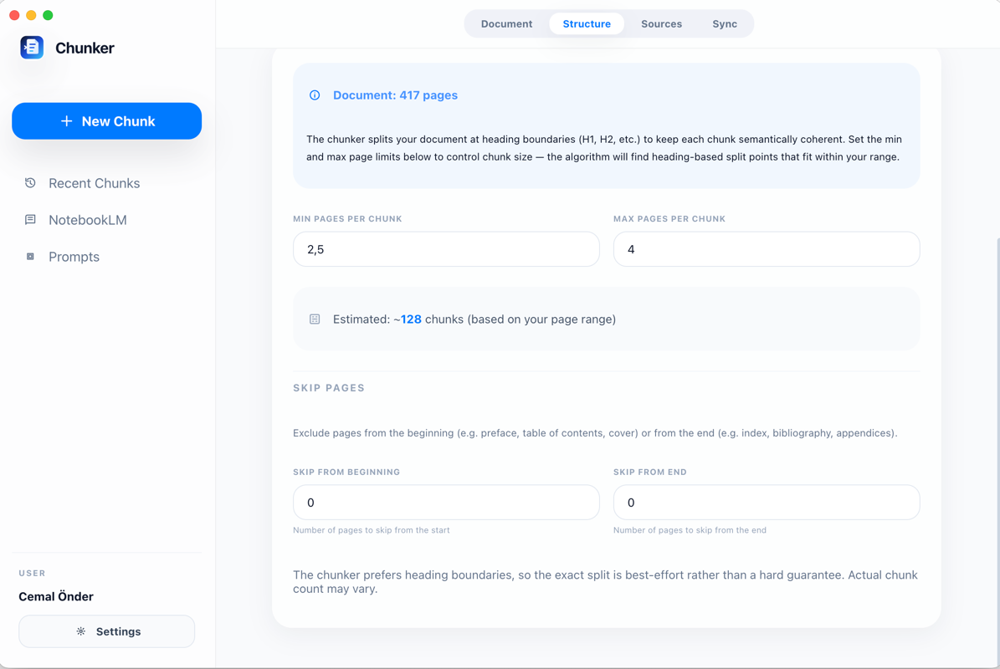
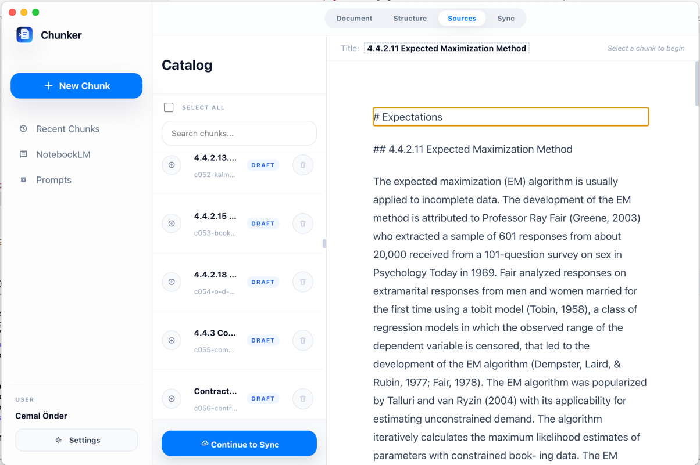
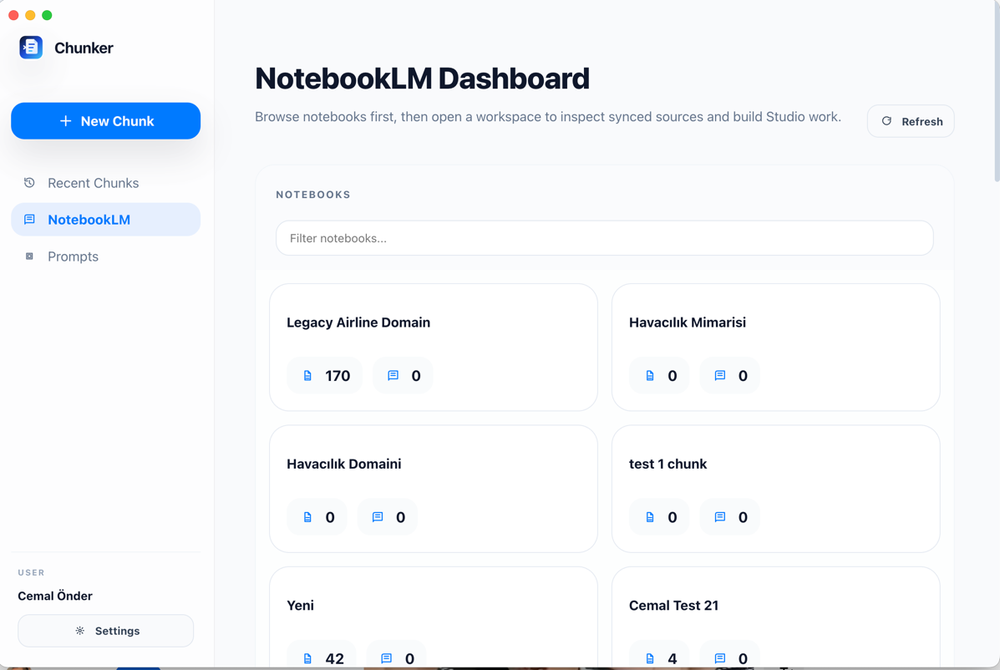
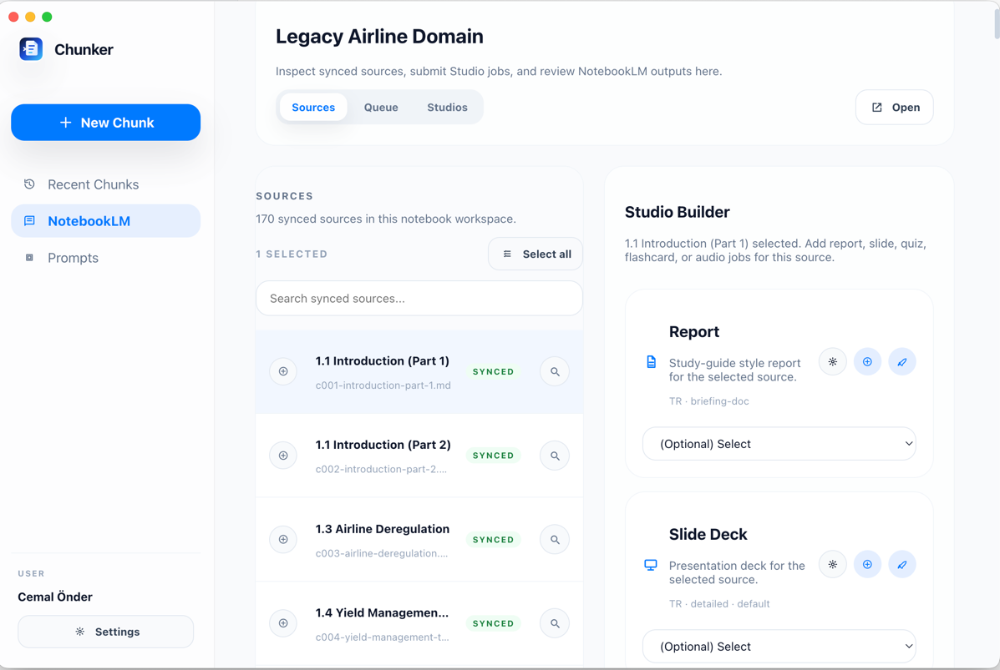
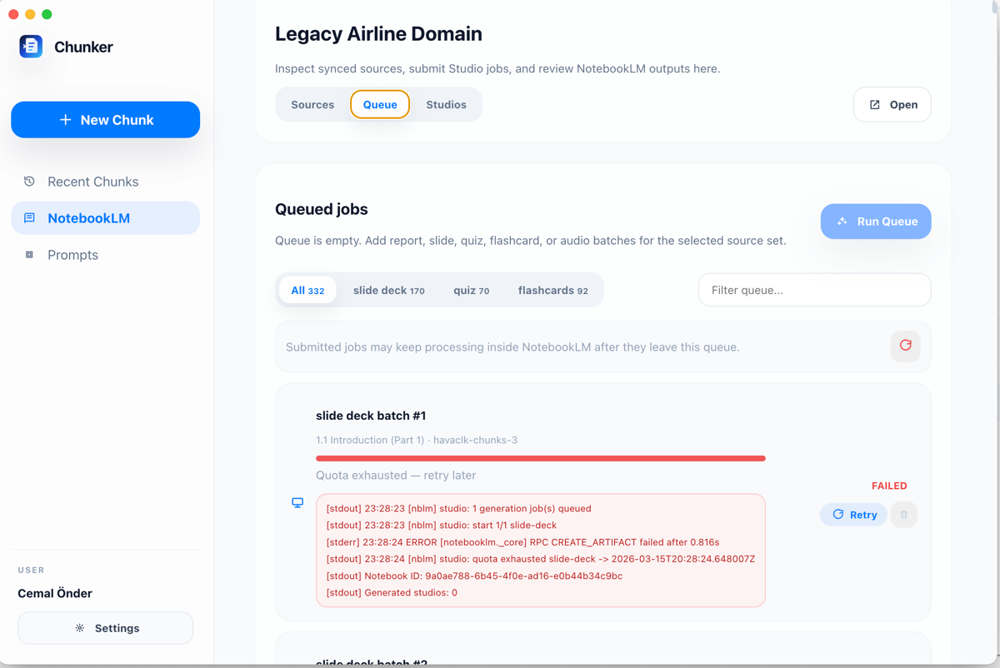
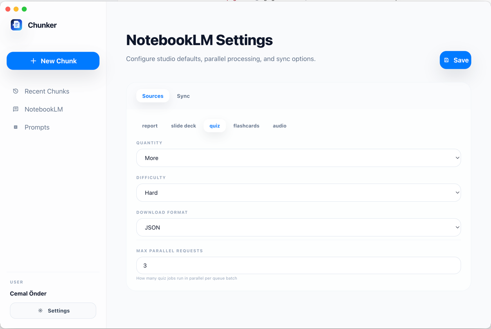

<p align="center">
  
</p>

<h1 align="center">notebooklm-chunker</h1>

<p align="center">
  <a href="https://github.com/cmlonder/notebooklm-chunker/actions/workflows/ci.yml"></a>
  <a href="https://github.com/cmlonder/notebooklm-chunker/actions/workflows/desktop-release.yml"></a>
  <a href="https://badge.fury.io/py/notebooklm-chunker"></a>
  <a href="https://opensource.org/licenses/MIT"></a>
</p>

<p align="center">Turn long documents into smaller, heading-aware NotebookLM sources so reports, slide decks, quizzes, flashcards, and audio outputs stay more focused and useful.</p>

## Install

**Desktop app** — download it from [GitHub Releases](https://github.com/cmlonder/notebooklm-chunker/releases), open it, and sign in with Google. Nothing else to install: the app carries its own `nblm` engine.

- **macOS**: `.dmg` or `.zip` (Apple Silicon)
- **Windows**: `.exe` installer or portable
- **Linux**: `.AppImage` or `.deb`

The builds are not code-signed. On macOS, open the app once, then allow it under System Settings → Privacy & Security → Open Anyway.

Sign-in opens a browser window. The app uses Google Chrome or Microsoft Edge if you have one, and otherwise downloads Chromium (about 150 MB) the first time.

**CLI** — the same engine from a terminal:

```bash
pip install notebooklm-chunker
nblm login
```

## Quick Start (CLI)

```bash
nblm init
nblm run --config ./nblm.toml
nblm resume --config ./nblm.toml
nblm studios --config ./quiz.toml
```

`run` starts fresh, `resume` continues an interrupted run, and `studios` adds Studio outputs later (here from a second workflow file) without re-uploading. Full reference: **[CLI.md](CLI.md)**.

## Desktop App

A visual workflow from PDF to NotebookLM Studio outputs.

### Chunk size

Set the page range per chunk and skip front matter or the index. Chunks split at headings; when the PDF has a table of contents, chapter starts win over sub-sections.



### Sources

Review, search, and edit chunks before syncing.



### NotebookLM

Browse your notebooks and open one to see its synced sources.



### Studio Builder

Pick sources, then queue any of the nine Studio types — report, slide deck, quiz, flashcards, audio, video, infographic, mind map, data table — for the selection or one per source.



### Queue

Track jobs by type and status. A Studio type that runs out of quota pauses and retries by itself; the others keep going.



### Studio defaults

Language, format, and parallel limits per Studio type.



### Also

| Feature | Description |
|---|---|
| **Resume** | Sync tracks each chunk, so an interrupted upload continues where it stopped |
| **Prompt library** | Reusable prompts per Studio type |
| **Versions** | Several chunkings of one PDF, each with its own sync and Studio state |
| **Accounts** | Switch between Google accounts |
| **Offline** | Chunk and edit without a network connection |

### Run from source (repo demo)

```bash
cd desktop
npm install
npm run dev
```

From source the app uses `nblm` from your PATH, or the bundled engine once you build it with `bash scripts/build_sidecar.sh`.

---

## Development

For setup, testing, packaging, and GitHub release flow, see [DEVELOPMENT.md](DEVELOPMENT.md).

## License

MIT
